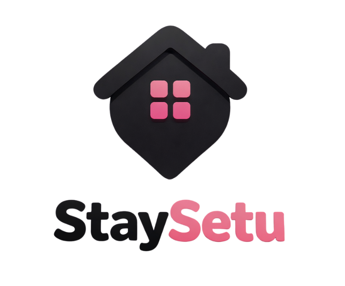

# 🏡 StaySetu — Student Living, Simplified

<p align="center">
  
</p>

<p align="center">
  <strong>Bridging the gap between students, verified stays, compatible roommates, and daily home essentials.</strong>
</p>

<p align="center">
  <a href="https://react.dev/"></a>
  <a href="https://vite.dev/"></a>
  <a href="https://tailwindcss.com/"></a>
  <a href="https://leafletjs.com/"></a>
  <a href="https://supabase.com/"></a>
  <a href="https://appwrite.io/"></a>
  <a href="#license"></a>
</p>

---

## 📖 About StaySetu

Finding a safe, comfortable, and affordable place near college shouldn't be stressful. **StaySetu** (*Stay + Setu / Bridge*) is an all-in-one student living ecosystem built to solve real ground-level problems faced by university students and young professionals.

Instead of unreliable classifieds and opaque brokers, StaySetu empowers students with:
1. **Direct Verified Stays**: Verified PGs, hostels, and shared flats with exact map coordinates, transparent pricing, and direct owner WhatsApp connectivity.
2. **Roommate Compatibility Engine**: Find roommates based on college, branch, sleep habits, budget, and lifestyle compatibility scores.
3. **Maid & Cook Directory**: Direct contact numbers for trusted local cooks and domestic help with transparent monthly rates.
4. **Resilient Dual-Backend**: Works out of the box with Supabase, Appwrite, or zero-config local mock persistence for instant local demos.

---

## 🌟 Key Features

### 🏠 1. Smart Housing Discovery & Interactive Map
- **Dual View Modes**: Switch seamlessly between responsive Grid Cards and full-screen **Interactive Leaflet Map**.
- **Location & College Filters**: Search stays near specific universities, metro stations, or popular student hubs.
- **Detailed Filters**: Filter by budget range, room type (Single, Double, Triple sharing, 1BHK, 2BHK), gender (Boys, Girls, Unisex), and AC/Food/WiFi amenities.
- **1-Click WhatsApp Booking**: Instantly schedule an in-person or video visit directly with verified property owners.

### 🤝 2. College Roommate Matcher
- **Algorithm-Driven Match Score**: Calculates lifestyle and study-habit compatibility percentages.
- **Requirement Posting**: Students can post their budget, preferred location, college, and habits.
- **Direct Connect**: One-tap WhatsApp chat and in-app connection requests to connect before booking.

### 🧹 3. Verified Maid & Cook Directory
- **Daily Living Support**: Solves the biggest challenge after moving in — finding hygienic home-cooked meals and reliable cleaning.
- **Direct Contact**: No agency cuts or hidden fees; call or WhatsApp verified local cooks and maids directly.
- **Price Transparency**: Clear monthly rate cards based on meal count and apartment size.

### 📊 4. Multi-Role Portals & Dashboards
- **Student Dashboard**: Track booked visits, saved favorite stays, active roommate requests, and chat threads.
- **Property Owner Dashboard**: Add/edit listings with multi-image & video upload support, track tenant leads, and toggle availability status (`Available`, `Rented Out`, `Sold Out`).
- **Admin Control Panel**: Review listings, verify property credentials, manage users, and curate local service providers.

### ⚡ 5. Zero-Friction Resilient Architecture
- **Offline / Local Demo Mode**: No backend credentials? StaySetu automatically defaults to a realistic in-memory & local-storage mock layer, allowing immediate evaluation and development out of the box.

---

## 🛠️ Tech Stack

| Layer | Technologies |
|---|---|
| **Frontend Framework** | [React 19](https://react.dev/) + [Vite](https://vite.dev/) |
| **Styling & UI** | [Tailwind CSS](https://tailwindcss.com/), [Lucide React](https://lucide.dev/), [Framer Motion](https://www.framer.com/motion/) |
| **Mapping & GIS** | [Leaflet](https://leafletjs.com/), [React-Leaflet](https://react-leaflet.js.org/) with OpenStreetMap tiles |
| **Backend & Database** | [Supabase](https://supabase.com/) & [Appwrite](https://appwrite.io/) dual-driver support |
| **Routing** | [React Router v7](https://reactrouter.com/) |
| **State & Context** | React Context API (`AuthContext`) with persistent session storage |

---

## 📂 Project Architecture

```plaintext
StaySetu/
├── public/                     # Static assets (logos, media, branding)
│   ├── logo.png
│   └── hero-brand.png
├── src/
│   ├── assets/                 # SVGs and bundled images
│   ├── components/             # Reusable UI components
│   │   ├── common/             # Navbar, Footer, PropertyCard, PropertyMap, Modals
│   │   ├── home/               # Hero, Bento Categories, EcosystemBenefits, Reviews
│   │   ├── layout/             # Section layouts, HowItWorks, Bento grids
│   │   └── listings/           # FilterPanel, SearchHeader, MapControls
│   ├── context/                # AuthContext & global session providers
│   ├── lib/                    # Supabase client, Appwrite SDK & local fallback mock data
│   │   ├── appwrite.js
│   │   ├── supabase.js
│   │   └── whatsappTracker.js
│   ├── pages/                  # Top-level page routes
│   │   ├── admin/              # AdminPanel.jsx
│   │   ├── auth/               # Login.jsx, Signup.jsx, VerifyEmail.jsx
│   │   ├── dashboard/          # StudentDashboard, OwnerDashboard, AddListing, EditListing
│   │   ├── Home.jsx            # Landing page with real feature showcases
│   │   ├── Listings.jsx        # Property search with grid & Leaflet map view
│   │   ├── PropertyDetails.jsx # Image gallery, video tour, amenities & visit scheduler
│   │   ├── Roommates.jsx       # Roommate matching engine & requirements board
│   │   ├── Maids.jsx           # Domestic help & cook directory
│   │   └── Messages.jsx        # In-app student-to-owner conversation inbox
│   ├── App.jsx                 # Route definitions & layout wrappers
│   ├── main.jsx                # Application root entry point
│   └── index.css               # Tailwind directives & custom design tokens
├── .env.example                # Environment variables template
├── package.json                # Project dependencies and npm scripts
├── tailwind.config.js          # Tailwind theme customization
└── vite.config.js              # Vite build and dev server config
```

---

## 🚀 Quick Start Guide

### 1. Prerequisites
Ensure you have the following installed on your machine:
* [Node.js](https://nodejs.org/) (version `18.x` or higher recommended)
* `npm` (bundled with Node) or `pnpm` / `yarn`

### 2. Clone the Repository
```bash
git clone https://github.com/your-username/staysetu.git
cd staysetu
```

### 3. Install Dependencies
```bash
npm install
```

### 4. Configure Environment (Optional)
StaySetu is configured to run **out-of-the-box in local demo mode** without any external setup. If you wish to connect your real Supabase or Appwrite database:

```bash
cp .env.example .env
```

Open `.env` and fill in your keys:
```env
# Option 1: Supabase (Recommended)
VITE_SUPABASE_URL=https://your-project.supabase.co
VITE_SUPABASE_ANON_KEY=your-supabase-anon-key

# Option 2: Appwrite (Alternative)
VITE_APPWRITE_ENDPOINT=https://sgp.cloud.appwrite.io/v1
VITE_APPWRITE_PROJECT_ID=your-appwrite-project-id
```

### 5. Launch the Development Server
```bash
npm run dev
```

Open your browser and navigate to:
```
http://localhost:5173
```

---

## 📦 Available Scripts

In the project root, you can run:

| Command | Action |
|---|---|
| `npm run dev` | Starts Vite local development server with Hot Module Replacement (HMR). |
| `npm run build` | Compiles and optimizes assets into the `dist/` directory for production. |
| `npm run preview` | Locally previews the production build output. |
| `npm run lint` | Runs ESLint to check code quality and rules. |

---

## 🌐 Deployment

### Deploying to Vercel
1. Push your repository to GitHub.
2. Import the project into [Vercel](https://vercel.com/).
3. Framework Preset: **Vite**.
4. Set Root Directory: `./`.
5. Under **Environment Variables**, add the keys from your `.env` file (if connecting to a live backend).
6. Click **Deploy**.

### Deploying to Netlify
1. Connect your repository on [Netlify](https://www.netlify.com/).
2. Build command: `npm run build`.
3. Publish directory: `dist`.
4. Add a `_redirects` file in `public/` with `/* /index.html 200` to support client-side routing.
5. Click **Deploy Site**.

---

## 🤝 Contributing

Contributions make the open-source community an incredible place to learn, inspire, and create. Any contributions you make are **greatly appreciated**.

1. Fork the Project (`gh repo fork`)
2. Create your Feature Branch (`git checkout -b feature/AmazingFeature`)
3. Commit your Changes (`git commit -m 'Add some AmazingFeature'`)
4. Push to the Branch (`git push origin feature/AmazingFeature`)
5. Open a Pull Request

---

## 🛡️ License

Distributed under the **MIT License**. See [`LICENSE`](LICENSE) for more information.

---

<p align="center">
  Made with ❤️ for students across India by the <strong>StaySetu Team</strong>.
</p>
